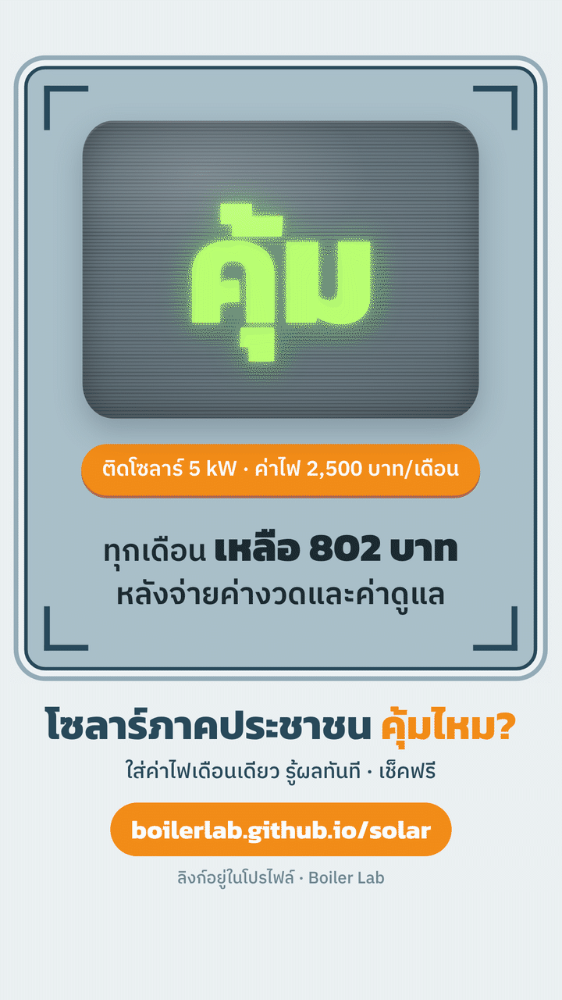

# โซลาร์ภาคประชาชน คุ้มไหม?

  

<b><a href="https://boilerlab.github.io/solar/">เปิดใช้งาน → boilerlab.github.io/solar</a></b>

เครื่องมือฟรีสำหรับคนที่สนใจโครงการโซลาร์ภาคประชาชน 2569 ตอบ 3 คำถามก่อนตัดสินใจ

1. **คุ้มไหม?** ใส่ค่าไฟต่อเดือน แอปบอกว่าคุ้ม พอไหว หรือยังไม่คุ้ม พร้อมเงินที่เหลือหรือต้องจ่ายเพิ่มต่อเดือน
2. **พื้นที่พอไหม?** ใส่ขนาดหลังคาหรือพื้นที่ เลือกแบบหลังคาและแบบวางแผง หรือวางแผงบนภาพดาวเทียม
3. **ติดกับใคร?** เช็คลิสต์เลือกช่าง และเทียบใบเสนอราคา 3 เจ้า

ไม่ต้องสมัคร ไม่เก็บข้อมูลส่วนตัว ตัวเลขเป็นการประมาณเบื้องต้น ควรให้ช่างดูหน้างานก่อนเซ็นสัญญา

ทำโดย Boiler Lab
